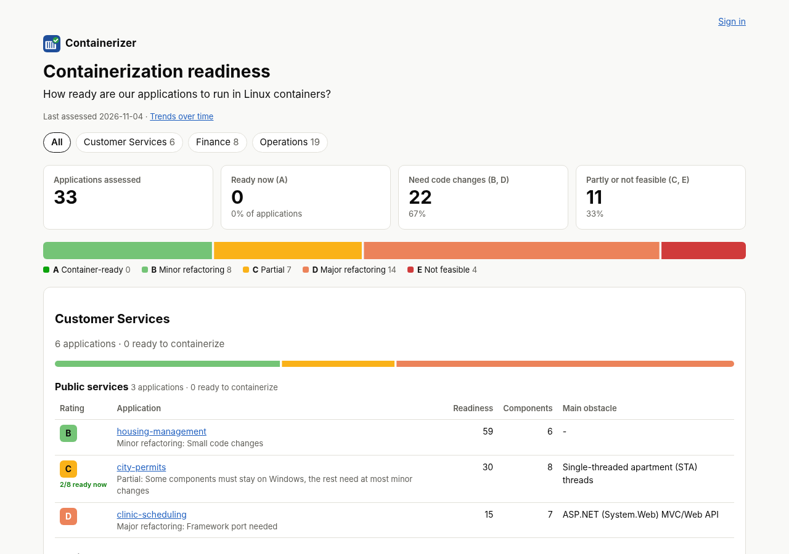

# Containerizer

Containerizer tells you which of your applications can run as Linux containers on Kubernetes, explains
why, and generates hardened container builds and Kubernetes manifests for the ones that can. It rates
every application from **A** (container-ready: a modern stack that runs in containers with configuration
only) to **E** (not feasible: stays on Windows), and proves its output by building, running and deploying
it in its own sandbox cluster.

<picture>
  <source media="(prefers-color-scheme: dark)" srcset="docs/images/results-overview-dark.png">
  
</picture>

- **Rules first, AI last.** Classification is done by a data-driven rule set (`rules/*.yaml`), and every
  finding comes with an explanation, a fix and references. An LLM is consulted only when the rules are
  unsure, and what it says is validated before it is used.
- **Learns by doing.** Failed builds are matched against failure rules, patched and retried, and fixes that
  work are proposed as new rules for a person to approve.
- **Secure by default.** Distroless, non-root images, read-only root filesystems and manifests that pass
  Pod Security `restricted`, with a vulnerability scan for every image.

It was built for the [onek8s containerization challenge](https://github.com/onek8s/containerization-challenge),
33 Windows-era .NET business applications, and for real-life portfolios.

## Documentation and downloads

- **Documentation:** [containerizer.eu](https://containerizer.eu), with
  [how it works](https://containerizer.eu/overview/) and
  [getting started](https://containerizer.eu/appliance/).
- **Downloads:** the appliance ISO with signed checksums are on the
  [releases](https://github.com/olljanat-ai/containerizer/releases) page, and the appliance OS image is
  `ghcr.io/olljanat-ai/containerizer-appliance`. See the [changelog](CHANGELOG.md) for what changed.

## Contributing

Issues and pull requests are welcome. To run the web UI and API on your own machine, see
[local dev server](docs/local-dev-server.md); tests are under `tests/` and the documentation site is built
from `docs/`. Rule changes go in `rules/`, and every refactor, rewrite or blocker rule needs a reference
link.

Pull requests run the unit tests (`python -m pytest -q -n auto`, with pytest-xdist) and the action's gate
automatically, and the security gate when they change the generators or the security rules. The heavy jobs (SQL
Server, the kind sandbox clusters, the one-shot assessment of the challenge apps) run by hand from the Actions tab
(**ci**, Run workflow) or on a pull request with the `full-ci` label; `ci/local.sh` runs all of them on one machine
([local dev server](docs/local-dev-server.md)).

## Licence

[MIT](LICENSE)
