# Results database and web UI

Assessments can be written to a Microsoft SQL Server database, and a small web UI shows them to
management grouped as **business unit → product → application → components**, with the rating, the
main obstacles and, for every component, what needs to change, why, and where to read more.

- The **scan** fills applications, their components and the results. Components are mapped to their
  application automatically (by project file path inside the application), and an application is
  recognised again on the next scan by its git remote and folder, so history builds up per application.
- **Administrators** maintain business units and products, and which application belongs to which
  product, on the [admin pages](#admin-pages) behind single sign-on. A scan never overwrites that.
- Scripts and other tools can do the same through a [JSON API](#api) with OAuth access tokens.
- Every change to that mapping is kept in an [audit log](#change-history-audit): who, when, what
  before and after.
- Optionally, the results pages need [sign-in too](#sign-in-for-the-results-pages-optional), and an
  [access log](#access-log-optional) records who signed in and which pages they opened.

```
BusinessUnit 1─* Product 1─* Application 1─* Component            administrators / scan
                             Application 1─* ApplicationAssessment   one per scan
                                              1─* ComponentAssessment 0─1 ComponentMigration   plan, AI agent prompt
                                              1─* Finding            why, fix, references
                             Application 1─* SandboxCheck         sandbox cluster health (org --verify-sandbox)
AuditLog                                                             every mapping change
AccessLog                                                            who looked at what (optional)
```

Everything lives in **one dedicated schema**, `containerizer` by default, and the database roles are
named after it, so the tables can share a database with other applications; nothing is created in
`dbo`. Pick another name with `Schema=` in every connection string (or `CONTAINERIZER_SQL_SCHEMA`).
The schema is in [`containerizer/sql/schema.sql`](../containerizer/sql/schema.sql) (SQL Server 2016 or
later, or Azure SQL Database). The examples below use the default name.

## Quick start (local, Docker)

```sh
cp results/.env.example results/.env          # set four strong passwords (and sign-in, see Admin pages)
docker compose -f results/compose.yaml up -d --build
# http://127.0.0.1:8080/ shows the (empty) portfolio

# scan an app into it, static analysis only (mount it under its real folder name):
docker compose -f results/compose.yaml run --rm -v "$PWD/../my-app:/apps/my-app:ro" scan assess /apps/my-app

# or from a checkout, with build-and-run verification (needs Docker and pip install -r requirements-sql.txt):
export CONTAINERIZER_SQL="Server=127.0.0.1,1433;Database=Containerizer;User Id=cz_scanner;TrustServerCertificate=yes"
export CONTAINERIZER_SQL_PASSWORD=...         # CZ_SCANNER_PASSWORD from results/.env
python -m containerizer analyze ../my-app
```

The compose stack runs SQL Server 2022 Developer edition, creates the database, the schema and three
logins (`cz_scanner`, `cz_web`, `cz_admin`, one per role below), and starts the web UI with a read-only
root filesystem, no Linux capabilities and `no-new-privileges`. All ports are published on 127.0.0.1
only. Developer edition is licensed for development and test, not production.

## Writing results

`assess` and `analyze` write to SQL Server when `--sql` or `CONTAINERIZER_SQL` is set:

```sh
export CONTAINERIZER_SQL="Server=tcp:sql.example.com,1433;Database=Containerizer;User Id=cz_scanner;Encrypt=yes"
export CONTAINERIZER_SQL_PASSWORD=...
python -m containerizer analyze path/to/repo        # or: assess path/to/repo
```

| Key | Meaning |
| --- | --- |
| `Server` | `host,port` (`tcp:` prefix allowed). Named instances (`host\instance`) are not supported: give the port. |
| `Database` / `Initial Catalog` | Database name. |
| `User Id` | SQL login. The password comes from `CONTAINERIZER_SQL_PASSWORD` (preferred: not visible in the process list or shell history) or `Password=`. |
| `Schema` | The dedicated schema (default `containerizer`). Not sent to the server. |
| `Encrypt` | `yes` (default) or `no`. |
| `TrustServerCertificate` | `no` (default) validates the server certificate against the system CAs; `yes` skips validation (local development with a self-signed certificate only). |
| `CaFile` | PEM file with the CA that signed the server certificate, when it is not in the system store. |

The defaults match Microsoft ODBC Driver 18: encrypted, certificate validated. Only SQL authentication
is supported (the driver is pymssql/FreeTDS); Microsoft Entra ID tokens and Windows integrated
authentication are not.

In a pipeline, install `requirements-sql.txt` next to `requirements.txt` and set the two variables
from the pipeline's secret store. With the GitHub Action, set them on the step; assess mode then
writes the verified results (the gate mode on pull requests does not write):

```yaml
- uses: olljanat-ai/containerizer@main
  with:
    mode: assess
  env:
    CONTAINERIZER_SQL: "Server=tcp:sql.example.com,1433;Database=Containerizer;User Id=cz_scanner"
    CONTAINERIZER_SQL_PASSWORD: ${{ secrets.CONTAINERIZER_SQL_PASSWORD }}
```

Each run inserts one `ApplicationAssessment` per application with its components, findings
(including runtime findings from `analyze`) and the full JSON report. Results from earlier runs can be
loaded too:

```sh
python -m containerizer db import containerizer-out/assessment.json --key-prefix "https://github.com/org/repo#"
```

The key prefix makes the application key match what a direct scan of the same repository would use
(`<repository URL>#<folder>`); without it the application name is the key.

## Setting up the database (production)

Run as a database owner once, and again after upgrading containerizer (it is idempotent):

```sh
CONTAINERIZER_SQL="Server=...;Database=Containerizer;User Id=<admin>" python -m containerizer db init
```

It creates the schema, its tables, views and audit triggers, and three database roles with least privilege:

| Role | For | Can |
| --- | --- | --- |
| `containerizer_writer` | the scanner (pipeline) | insert results; update only the scan-owned columns of `Application` and `Component` |
| `containerizer_reader` | the web UI's results pages, report readers | read the `v*` views, ratings, business units, products; not the raw JSON reports |
| `containerizer_admin` | the web UI's admin pages | everything the reader can, plus edit business units, products and the people-maintained columns of `Application`; read the audit log |

No role may update or delete audit rows. Create one login per use and add it to a role, for example:

```sql
-- in master
CREATE LOGIN cz_scanner WITH PASSWORD = N'<strong password>', CHECK_POLICY = ON;
CREATE LOGIN cz_web     WITH PASSWORD = N'<strong password>', CHECK_POLICY = ON;
CREATE LOGIN cz_admin   WITH PASSWORD = N'<strong password>', CHECK_POLICY = ON;
-- in the database
CREATE USER cz_scanner FOR LOGIN cz_scanner;  ALTER ROLE containerizer_writer ADD MEMBER cz_scanner;
CREATE USER cz_web     FOR LOGIN cz_web;      ALTER ROLE containerizer_reader ADD MEMBER cz_web;
CREATE USER cz_admin   FOR LOGIN cz_admin;    ALTER ROLE containerizer_admin  ADD MEMBER cz_admin;
```

On Azure SQL Database use contained users instead (`CREATE USER cz_web WITH PASSWORD = ...`). Keep the
passwords in your pipeline's or platform's secret store.

### TLS

The server must present a certificate the client trusts. With an internal CA, either add the CA to
the system store of the machine or container that runs containerizer, or pass `CaFile=/path/ca.pem`.
Azure SQL Database certificates are trusted by default. Use `TrustServerCertificate=yes` only for a
local development server.

## Useful queries

```sql
-- portfolio by business unit and product
SELECT COALESCE(BusinessUnitName, N'(not assigned)') AS BusinessUnit,
       COALESCE(ProductName, N'(not assigned)') AS Product,
       ApplicationName, Rating, RatingTitle, Score, EffortDays, AssessedAt
FROM containerizer.vApplicationLatest ORDER BY BusinessUnit, Product, Rating, ApplicationName;

-- rating of every application per scan, with the obstacles that scan found (what /trends reads)
SELECT ApplicationName, AssessedAt, Rating, Blockers, Rewrites
FROM containerizer.vAssessmentHistory ORDER BY ApplicationName, AssessedAt;

-- rating mix and effort per business unit
SELECT COALESCE(BusinessUnitName, N'(not assigned)') AS BusinessUnit, Rating, COUNT(*) AS Applications,
       SUM(EffortDays) AS EffortDays
FROM containerizer.vApplicationLatest GROUP BY BusinessUnitName, Rating ORDER BY BusinessUnit, Rating;

-- the most common blockers across the portfolio
SELECT Title, Severity, COUNT(DISTINCT ApplicationId) AS Applications
FROM containerizer.vFindingLatest WHERE Severity IN ('blocker', 'rewrite')
GROUP BY Title, Severity ORDER BY Applications DESC;

-- components of one application
SELECT ComponentName, Role, Verdict, VerdictText, EffortDays, VerifyStatus
FROM containerizer.vComponentLatest WHERE ApplicationName = N'parts-catalog';

-- migration assistant: effort to move the not-ready components, and their AI coding agent prompts
SELECT ApplicationName, ComponentName, Outcome, EffortDays, ItemCount, AgentPrompt
FROM containerizer.vComponentMigrationLatest ORDER BY EffortDays;
```

## Web UI

```sh
export CONTAINERIZER_SQL="Server=...;Database=Containerizer;User Id=cz_web" CONTAINERIZER_SQL_PASSWORD=...
python -m containerizer web              # http://127.0.0.1:8080/  (--host, --port)
```

or the `web` service of `results/compose.yaml` / the image built from `results/Dockerfile`.

- **Overview**: number of applications, how many are ready now, need code changes or are partly or not
  feasible, total estimated effort, the rating mix, then each business unit and product (with a link
  to the product's page in your product catalogue, when one is set) with its applications, their
  rating in words, readiness, effort and main obstacle. Filter by business unit with the buttons at
  the top.
- **Application**: rating and what it means, readiness, effort, confidence, main obstacles, the
  components (what each one is and its verdict), and per component every item to change with why, how
  to fix it and links to the documentation; the rating history.
- **Migration assistant** (per component that is not ready): the concrete replacements from
  [`rules/migrations.yaml`](../rules/migrations.yaml) (what to replace with what, packages, effort,
  references) and a **prompt for an AI coding agent** (Claude Code, GitHub Copilot, ...) with the
  findings and their evidence, the plan, constraints (minimal changes, security, container readiness)
  and how to verify. Copy it with the button, or open it as plain text at
  `/app/<id>/component/<id>/agent-prompt.md`.
- **Trends** (`/trends`, linked from the overview): how the portfolio changed from scan to scan. The
  headline numbers compare now with the start of the range (applications assessed, ready now, obstacles
  that cannot run in a Linux container, how many applications got a better or worse rating), then the
  rating mix and the obstacles at the end of every day, week, month or quarter (picked from the range),
  and each application's rating per period with its change. Filter by time range (last 3 months, last
  12 months, all time), business unit and, within a business unit, product. Every chart has a table view
  and a tooltip on every mark.

Every scan is kept, so the trends need nothing extra: the state of an application at the end of a
period is its latest scan up to then (a period without a scan repeats the previous result), and an
application appears from its first scan. Obstacles are the distinct rules with the severity "cannot run
in a Linux container" or "needs a port or rewrite" in that scan, added up over the applications.
Applications are grouped by their current business unit and product, so remapping an application moves
its whole history; retired applications are left out. The page reads `vAssessmentHistory`, which the
reader role can select (schema version 3; run `db init` after upgrading).

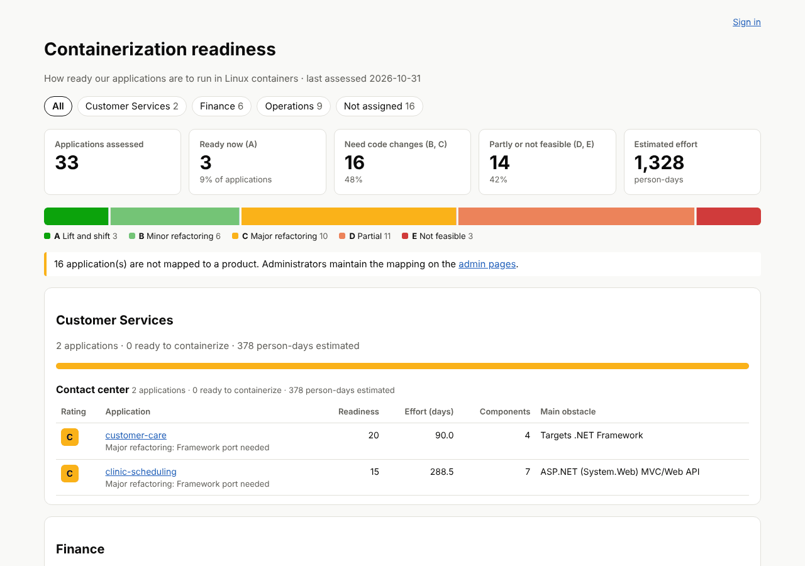

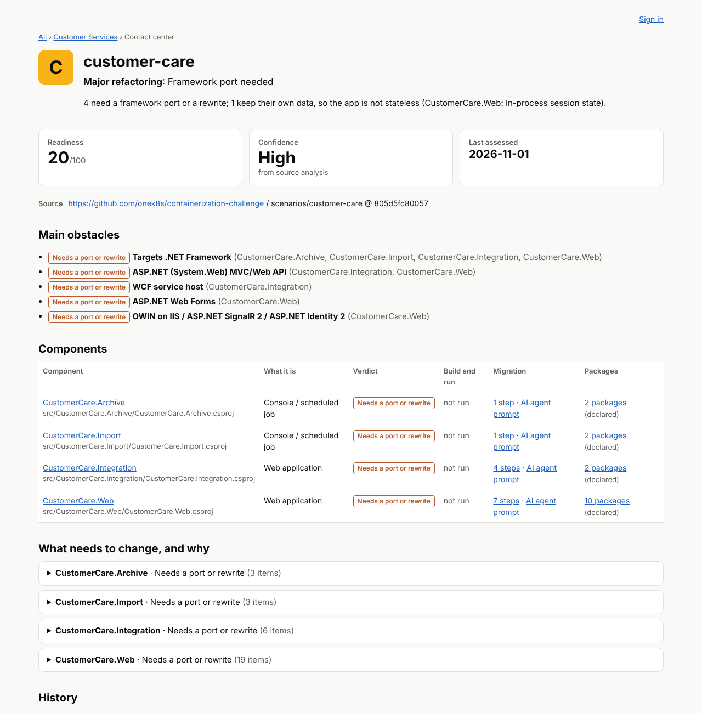

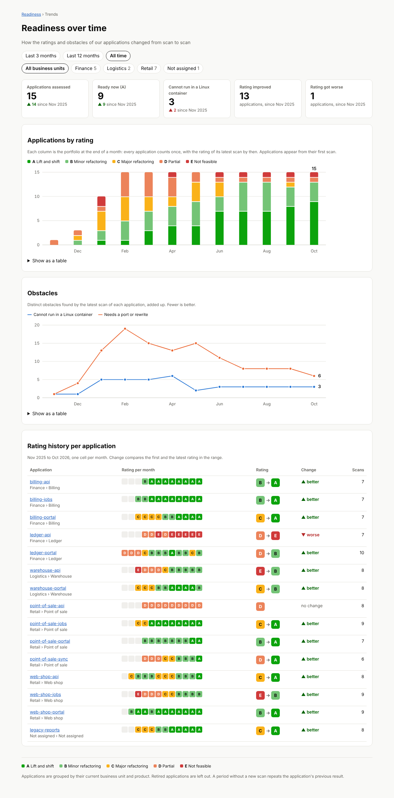

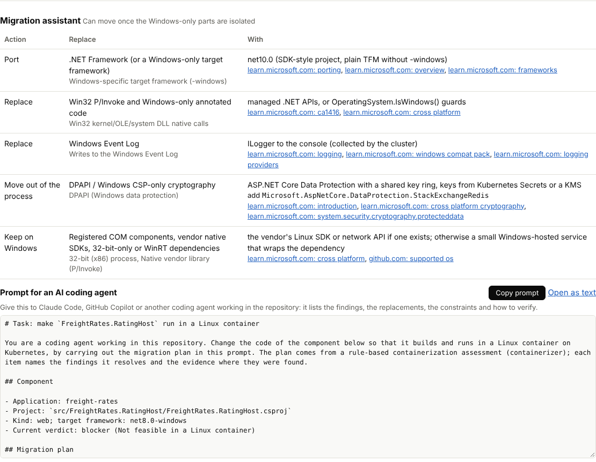

<details><summary>Dark mode</summary>

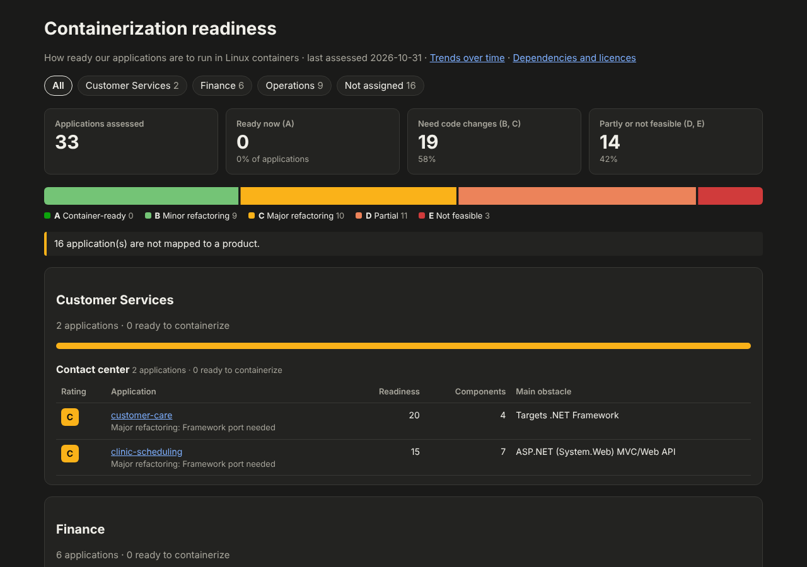

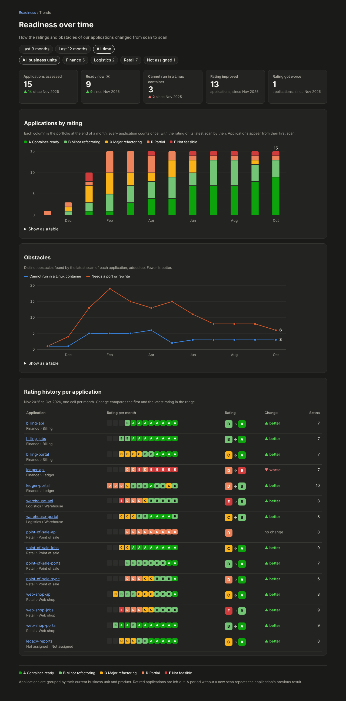

</details>

The results pages need no sign-in unless you [turn it on](#sign-in-for-the-results-pages-optional),
and only read (through the reader login). Pages are rendered on the
server; the only script is the prompt's copy button (`/static/app.js`, `script-src 'self'`, everything
works without it); all text is escaped; responses carry a strict Content-Security-Policy
(`default-src 'none'`, no inline script), `X-Frame-Options: DENY`, `nosniff`, `Referrer-Policy: same-origin` and
`no-store`; errors are logged on the server and never shown. Run it behind a TLS-terminating reverse
proxy or ingress, and keep it off the internet.

## Admin pages

`/admin` lets administrators, after signing in with your identity provider (OpenID Connect: Microsoft
Entra ID, Okta, Keycloak, Google Workspace, ...), do the following. Product owners can do part of it
for their own products, and operators run the scans; see [Roles](#roles).

- **Application mapping**: list the applications that are not mapped yet (or all, or hidden ones),
  select several and map them to a product in one go, or open one to set its product, a display name
  shown instead of the folder name, an owner, a description, or hide it from the results (retired;
  its history is kept).
- **Products**: add, rename, put in a business unit, set an owner and a **product page link** (https
  link to the product in another tool, for example the CMDB or product catalogue, shown next to the
  product in the results), delete when nothing is mapped to it.
- **Business units**: add, rename, set an owner, delete when no product is in it.
- **Organization scans** and **Repositories**: schedule whole-organization scans, run one now, and
  enable or disable the repositories they found (skipped ones are shown disabled with the reason).
  See [scheduled-scans.md](scheduled-scans.md).
- **Change history**: see below.

They appear when sign-in is configured; without it the UI is the read-only results only.

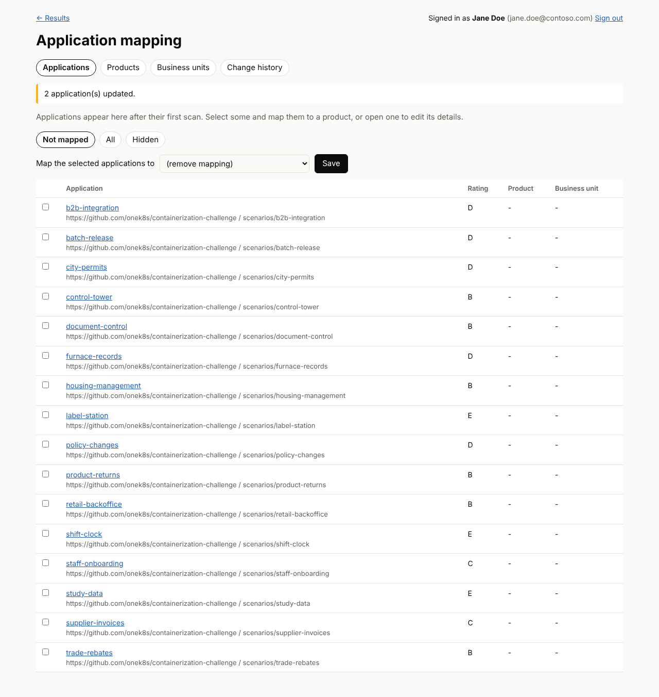

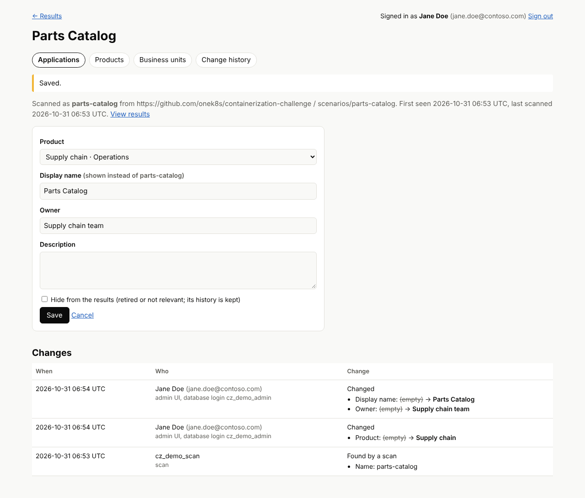

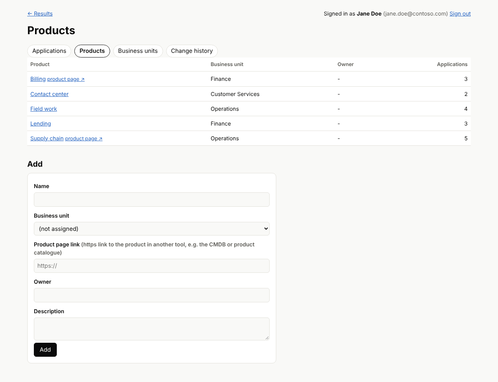

| Variable | Meaning |
| --- | --- |
| `CONTAINERIZER_OIDC_ISSUER` | Issuer URL, e.g. `https://login.microsoftonline.com/<tenant id>/v2.0` (Entra ID), `https://<org>.okta.com`, `https://<keycloak>/realms/<realm>` |
| `CONTAINERIZER_OIDC_CLIENT_ID` / `CONTAINERIZER_OIDC_CLIENT_SECRET` | The app registration. The secret is optional (PKCE is always used); prefer a confidential client. |
| `CONTAINERIZER_PUBLIC_URL` | The address users open, e.g. `https://containerizer.example.com`. The redirect URI to register is this plus `/auth/callback`. |
| `CONTAINERIZER_ADMINS` | Who is an administrator, comma separated: `group:<group object id>`, `role:<app role>`, `email:<address>`, `domain:<e-mail domain>`, `sub:<subject id>`. `email:` and `domain:` only match when the provider marks the address verified (`email_verified`). Nobody else gets in. |
| `CONTAINERIZER_ADMIN_SQL` / `CONTAINERIZER_ADMIN_SQL_PASSWORD` | Connection string and password of the `containerizer_admin` login the admin pages write with. |
| `CONTAINERIZER_GRAFANA_URL` | Optional. Link to your Grafana dashboard of the scans ([scheduled-scans.md](scheduled-scans.md#grafana-dashboard)), shown to administrators and operators as a **Grafana ↗** tab on the admin pages and a link on Organization scans. `https://` only (`http://` only to `localhost`); checked at start. |
| `CONTAINERIZER_OIDC_SCOPES` | Default `openid profile email`. |

With **Microsoft Entra ID**: register a web application with the redirect URI above, add a client
secret, and either create an app role (for example `Containerizer.Admin`, assigned to a group in
Enterprise applications; then `CONTAINERIZER_ADMINS=role:Containerizer.Admin`) or emit group claims
(`group:<object id>`). Entra ID does not send `email_verified`, so use `role:` or `group:` there.

Security: authorization code flow with PKCE (S256), `state` and `nonce`; the ID token's signature is
verified with the provider's published keys, as are issuer, audience and expiry (unsigned and HMAC
tokens are refused). The session is a random id in an `HttpOnly`, `SameSite=Lax` cookie (`Secure` and
`__Host-` prefixed on https), new at every sign-in, ending after 8 hours or 1 hour idle, or at sign-out.
Every form carries a per-session CSRF token and cross-site posts are refused by `Origin`; after sign-in
only same-site paths are followed. HTTPS is required for the issuer and the public URL (plain http only
for `localhost`), and on https the UI sends HSTS. Sessions are kept in the server's memory: run one
instance, and a restart signs everyone out.

## Roles

Who signs in gets one or more roles, from the same kind of allow-list rules as `CONTAINERIZER_ADMINS`
(`group:`, `role:`, `email:`, `domain:`, `sub:`):

| Role | Set with | Can |
| --- | --- | --- |
| Viewer | `CONTAINERIZER_VIEWERS` | Read the results pages. Only matters when [sign-in for the results pages](#sign-in-for-the-results-pages-optional) is on. |
| Product owner | `CONTAINERIZER_PRODUCT_OWNERS` | Read everything, including the change history. Map applications, and change their display name, owner, description and hidden flag, but only for the business units or products in their scope. Change the name, owner, description and product page link of their products. With a business unit in scope, also add products to it and delete empty ones. |
| Operator | `CONTAINERIZER_OPERATORS` | Read everything, including the change history. Run and schedule organization scans, enable and disable repositories, and open the Grafana link on the scheduled scan pages. Upload [dev database backups](dev-databases.md) for the sandbox. Cannot change the mapping. |
| Admin | `CONTAINERIZER_ADMINS` | Everything, including business units and the [access log](#access-log-optional). |

Admins, operators and product owners can always read the results pages; nobody else gets into
`/admin`. The access log is for admins only. One person can have several roles; the admin role
includes all of them.

**Product owner scopes.** `CONTAINERIZER_PRODUCT_OWNERS` maps rules to the business units or products
they cover. Each entry is `<rules>=<scopes>`; entries are separated by `;`, and the rules and scopes in
an entry by `,`:

```sh
CONTAINERIZER_PRODUCT_OWNERS="role:Finance.Owner=bu:Finance; group:6f1c...=product:Billing,product:#12"
```

- `bu:<name>`: a business unit and every product in it, now and later.
- `product:<name>`: one product and its applications.
- `bu:#<id>` / `product:#<id>`: the same by id (the number in the admin page address). An id keeps
  working after a rename. A name scope follows the name: if a product is renamed, the old name no
  longer matches anything. Names are matched without regard to case and cannot contain `,` `;` `=`.

A product owner can take over applications that are not mapped yet by mapping them to one of their
products. They can move their own applications between their products, or unmap them. They cannot
touch applications or products outside their scope. Those still show on the admin pages, marked
*view only*. Scopes are checked against the database on every request, so a product moved to
another business unit leaves (or joins) a business unit owner's scope right away.

With **Microsoft Entra ID**, create one app role per role and assign it to groups, for example
`Containerizer.Admin`, `Containerizer.Operator`, `Containerizer.Read`, and one per owned business
unit such as `Finance.Owner`. Then:

```sh
CONTAINERIZER_ADMINS=role:Containerizer.Admin
CONTAINERIZER_OPERATORS=role:Containerizer.Operator
CONTAINERIZER_VIEWERS=role:Containerizer.Read
CONTAINERIZER_PRODUCT_OWNERS="role:Finance.Owner=bu:Finance; role:Operations.Owner=bu:Operations"
```

The roles are enforced by the web UI and the API. All writes use the one `containerizer_admin`
database login, so the database itself does not tell the roles apart. Every change records the
role it was made in (see [change history](#change-history-audit)).

## Sign-in for the results pages (optional)

By default anyone who can reach the web UI can read the results. To limit that to named people, set
`CONTAINERIZER_VIEWERS` next to the [admin sign-in settings](#admin-pages); it uses the same identity
provider and app registration, so nothing new is registered.

| Variable | Meaning |
| --- | --- |
| `CONTAINERIZER_VIEWERS` | Who may see the results, comma separated, with the same rules as `CONTAINERIZER_ADMINS` (`group:`, `role:`, `email:`, `domain:`, `sub:`). Administrators may always see them. Empty (the default): no sign-in for the results pages. |
| `CONTAINERIZER_VIEW_AUDIT` | `true` to record sign-ins and page views in the [access log](#access-log-optional). Needs `CONTAINERIZER_VIEWERS`. Default `false`. |

With it set, opening any results page (`/`, `/app/<id>`, `/trends`) without a session sends the browser straight
to the identity provider, with no sign-in page in between, and back to the page that was asked for
after sign-in. Users the provider signs in who match neither list get a "not allowed" page and see no
results; the database is not read for them. Only `/healthz` and the style sheet stay open. Signed-in
users see their name and a **Sign out** button at the top. The [API](#api) is not affected: it always
needs an access token.

With **Microsoft Entra ID**, the simplest set-up is a second app role, for example
`Containerizer.Read`, assigned to the groups that may read the results:
`CONTAINERIZER_VIEWERS=role:Containerizer.Read`. To let everyone in your organisation in, assign the
role to an all-employees group, or turn on *Assignment required* for the enterprise application and
assign the role to the users and groups who need it.

## API

The same changes can be made by scripts and other tools through a JSON API under `/api/v1`, turned on
with two more settings next to the sign-in ones:

| Variable | Meaning |
| --- | --- |
| `CONTAINERIZER_API_AUDIENCE` | The audience the access tokens must be issued for, e.g. `api://containerizer` (Entra ID: the Application ID URI of the app registration). |
| `CONTAINERIZER_API_CLIENTS` | Automation that may change everything, comma separated: `client:<client id>` (the token's `azp`, `appid` or `client_id`), `role:<app role>`, `group:`, `email:`, `domain:`, `sub:` as for admins. Optional when the roles below are enough. |

The [roles](#roles) apply to API tokens too, with the token's claims matched against the same rules.
Admins can change everything. Product owners can change only their own products and applications,
and get 403 `forbidden` outside them. Operators can only read. Anyone who matches no role gets 403
`insufficient_scope`.

Callers send `Authorization: Bearer <access token>` from the same identity provider: the
client-credentials flow for automation, or a user's token. The token's signature (the provider's
published keys), issuer, audience and expiry are checked; an ID token is not accepted (its audience
is the web app, not the API). Cookies are ignored, so the API has no CSRF surface. Bodies are JSON
(`Content-Type: application/json`, up to 64 KiB); unknown fields are refused.

| Method and path | Does |
| --- | --- |
| `GET /api/v1/business-units` · `POST` | list (`?name=`) · create `{"name", "owner", "description"}` |
| `GET` · `PATCH` · `PUT` · `DELETE /api/v1/business-units/{id}` | read · change some fields · replace · delete (409 while products are in it) |
| `GET /api/v1/products` · `POST` | list (`?name=`, `?businessUnitId=`) · create `{"name", "businessUnitId", "infoUrl", "owner", "description"}` |
| `GET` · `PATCH` · `PUT` · `DELETE /api/v1/products/{id}` | as above (409 while applications are mapped to it) |
| `GET /api/v1/applications` | list with the latest rating (`?unmapped=true`, `?productId=`, `?name=`, `?retired=true`) |
| `GET` · `PATCH /api/v1/applications/{id}` | read · set `productId`, `displayName`, `owner`, `description`, `retired` (applications themselves come from scans) |
| `GET /api/v1/audit` | the change history (`?table=Application`, `?rowId=`, `?limit=` up to 1000) |

Errors are `{"error": "...", "message": "..."}` with 400 (invalid field), 401 (no or bad token),
403 (caller not allowed), 404, 405, 409 (name taken, referenced row missing or still in use), 413, 415.

```sh
# Entra ID client credentials (register a second app as the client, grant it the API's app role)
TOKEN=$(curl -s https://login.microsoftonline.com/$TENANT/oauth2/v2.0/token \
  -d grant_type=client_credentials -d client_id=$CLIENT_ID -d client_secret=$CLIENT_SECRET \
  -d scope=api://containerizer/.default | jq -r .access_token)
API=https://containerizer.example.com/api/v1

# map every unmapped application from one repository to the Billing product
PRODUCT=$(curl -s -H "Authorization: Bearer $TOKEN" "$API/products?name=Billing" | jq '.items[0].id')
curl -s -H "Authorization: Bearer $TOKEN" "$API/applications?unmapped=true" \
  | jq -r '.items[] | select(.repositoryUrl == "https://dev.azure.com/contoso/Billing/_git/billing") | .id' \
  | while read id; do
      curl -s -X PATCH -H "Authorization: Bearer $TOKEN" -H "Content-Type: application/json" \
        -d "{\"productId\": $PRODUCT}" "$API/applications/$id"
    done
```

With Entra ID, set `accessTokenAcceptedVersion` to `2` in the API app's manifest so its access tokens
carry the same v2.0 issuer as the sign-in, define an app role (e.g. `Containerizer.Write`, allowed
member type Applications) and grant it to the client app; then
`CONTAINERIZER_API_CLIENTS=role:Containerizer.Write`.

API changes are written with the admin database login and appear in the change history with
**Via** `API` and **ChangedBy** the user's e-mail for a user's token, or `client:<client id>` for an
application.

## Change history (audit)

Every insert, update and delete of a business unit, a product (including its product page link and
business unit) and of an application's mapping and details is written to `containerizer.AuditLog` by
database triggers, so changes made outside the admin pages, directly with SQL, are recorded too. Each
row has:

- **ChangedBy / ChangedByName**: the signed-in person (e-mail or user name, and display name) for
  changes from the admin pages, the user or `client:<client id>` for the API; the database login for
  anything else.
- **ChangedByRole**: the role the change was made in: `admin`, `product owner`, `operator`, or
  `API client` for callers on `CONTAINERIZER_API_CLIENTS`. Empty for scans and direct SQL.
- **DbLogin**: the actual database login that ran the statement, always.
- **Via**: `admin UI`, `API`, `scan` (a new application found by a scan) or `SQL`.
- **ChangedAt** (UTC), **TableName**, **RowId**, **RowName**, **Action** (`insert`, `update`, `delete`).
- **OldValues / NewValues**: the values before and after, as JSON, with product and business unit
  names rather than ids, so the history stays readable after renames and deletes.

The admin pages show it under **Change history**, filterable by kind, and on each application, product
and business unit page. The admin pages and the API put the signed-in user or client in the connection's `SESSION_CONTEXT`
as read-only, so it cannot be changed on that connection. No role can update or delete audit rows;
database owners can, so forward the table to your SIEM if it must be tamper-proof.

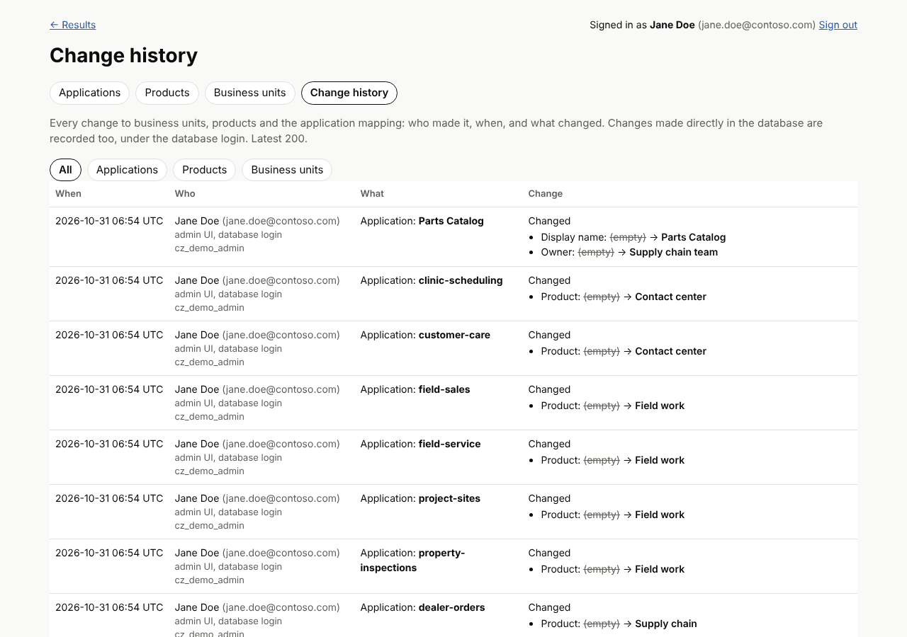

```sql
-- who changed what in the last 30 days
SELECT ChangedAt, COALESCE(ChangedByName, ChangedBy) AS Who, Via, TableName, RowName, Action, OldValues, NewValues
FROM containerizer.AuditLog WHERE ChangedAt > DATEADD(day, -30, SYSUTCDATETIME()) ORDER BY ChangedAt DESC;
```

## Access log (optional)

With `CONTAINERIZER_VIEW_AUDIT=true` (and [sign-in for the results pages](#sign-in-for-the-results-pages-optional)),
the web UI writes one row to `containerizer.AccessLog` for:

- every **sign-in** (`sign-in`), and every sign-in of someone who is not on the viewer or admin list
  (`sign-in refused`);
- every **results page opened** (`view`): the overview (with the business unit filter, if one was
  used), the trends page (with its range and filters) or an application's page, with its
  `ApplicationId`;
- every **sign-out** (`sign-out`).

Each row has **At** (UTC), **UserName** (e-mail or user name, as in the change history),
**DisplayName**, **Event**, **Path**, **ApplicationId**, **ClientAddress** (the address the request
came from; behind a reverse proxy that is the proxy) and **DbLogin**. The admin pages and the API are
not in this log: changes are in the [change history](#change-history-audit), and admin page views are
not recorded.

Administrators see it on the admin pages under **Access log**: the latest 200 entries, and, by
clicking a person or "who else" next to an application, everything one person opened or everyone who
opened one application.

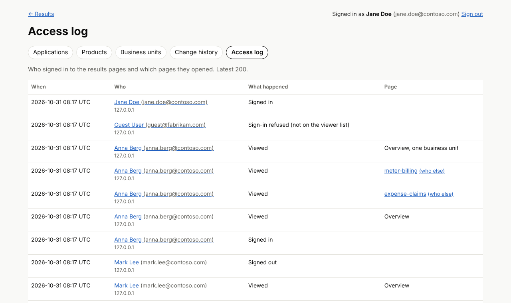

The web UI writes the log through its admin login, which may only insert and read it; no role can
change or delete rows. If a row cannot be written, the page is not shown (an error instead), so a
view is never left unrecorded. Like the change history, forward it to your SIEM if it must be
tamper-proof.

The access log is personal data: tell users that their access is recorded, and keep it only as long
as your policy says; removing old rows needs a database owner (second query below).

```sql
-- who opened an application's results in the last 30 days
SELECT l.At, COALESCE(l.DisplayName, l.UserName) AS Who, COALESCE(a.DisplayName, a.Name) AS Application
FROM containerizer.AccessLog l JOIN containerizer.Application a ON a.ApplicationId = l.ApplicationId
WHERE l.Event = N'view' AND l.At > DATEADD(day, -30, SYSUTCDATETIME()) ORDER BY l.At DESC;

-- retention: delete entries older than 400 days (database owner)
DELETE containerizer.AccessLog WHERE At < DATEADD(day, -400, SYSUTCDATETIME());
```
