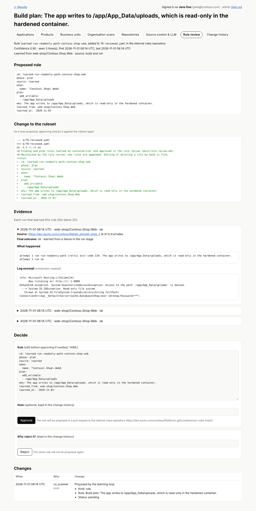

# Rule review

The learning loop of a scan builds and runs applications, matches failures against the failure rules,
patches the build plan and retries ([how it works](overview.md#self-learning-loop)). Nothing it learns
enters the ruleset until an administrator approves it under **Admin → Rule review**:

1. **The run uses what it learns, and nothing else does.** A learning run works on a staging copy of the
   learned rules, so its own result is as good as it can be while the rules other runs read stay
   unchanged.
2. **What it learned waits as a candidate** with its evidence: every new finding or plan rule, failure
   rule and Linux-safe package.
3. **A person decides**: approve (after editing the rule in the text box, if needed) or reject with a
   reason. Rejected rules are not proposed again. Every decision is in the change history.
4. **Approved rules go into your internal rules repository**, never into this tool's public `rules/`
   folder: what your applications taught the tool stays inside your organization.

## What a candidate shows

| | |
| --- | --- |
| Kind | A finding or plan rule (`70-reviewed.yaml`), a failure rule of the build-and-run loop (`55-reviewed-failures.yaml`), or a package proven to work on Linux (`packages-reviewed.yaml`) |
| Source | `learned` (from a build and run) or `ai` (proposed by the LLM, with the model's name) |
| Confidence | The rule's own confidence if it has one (0.7 for LLM rules), else 0.9 when the container built and ran with it, 0.8 for a failure observed at runtime, 0.6 otherwise |
| Seen | How many runs learned the same rule. The same condition and effect learned again adds evidence to the existing candidate, whatever its id or wording |
| Evidence | For each run (the latest 20): repository and commit, application and component, every attempt (which failure rule matched, its outcome, the exit code, the diagnosis), and the tail of the failing log |

Logs are stored with credentials masked (passwords and keys in connection strings, `Authorization`
headers, user:password in URLs, JSON web tokens, private keys). The masking catches the common forms,
not every secret an application can print, so rule review is for administrators only.

## What approval checks

A learned rule has to meet the same bar as the curated ones:

- a unique id (lower-case letters, digits, `.`, `-`, `_`), not already used by a curated or approved rule;
- every regular expression in `when` compiles; the condition is not empty;
- finding rules: a title, a `why` of at least 60 characters, a `fix`, and at least one https reference
  for refactor, rewrite and blocker findings;
- plan rules and failure-rule fixes only use known build-plan keys;
- failure rules: stage, outcome and a `match` that does not match an empty log;
- packages: a valid expression that does not match (almost) any package name.

## Setting up the internal rules repository

1. Create a private or internal Git repository for the approved rules. It needs one commit (a README
   is enough); the rules folder is created by the first approval.
2. Under **Admin → Source control**, add a **write token** for that repository's URL. It must be able
   to push a branch and open a pull request in that one repository: GitHub fine-grained token with
   **Contents** and **Pull requests: Read and write**, GitLab project access token with the role
   **Developer** and the scopes **api** and **write_repository**, or Azure DevOps **Code: Read & write**.
3. Under **Admin → Rule review → Internal rules repository**, enter the repository URL, the branch the
   pull requests target (default `main`) and the folder of the rules in it (default `rules`). The
   provider is worked out from the URL for github.com, gitlab.com and `gitlab.*` hosts, dev.azure.com
   and `*.visualstudio.com`; choose it for other servers, and give the API URL of a self-hosted
   GitHub Enterprise Server or GitLab if it is not at the usual address.
4. Allow the Git server on **Admin → Firewall**.

Until all of this is in place, the Rule review page says what is missing, and candidates keep waiting.
The settings are in the change history.

Like every source control token, the write token is sealed for the scan worker: the web UI cannot use
it. So approving hands the rule to the scan worker, which opens the pull request within a minute, also
while a scan is running. The candidate shows *the pull request is being opened* until then, and
*approved* with the pull request's link after. If it fails (a token without the permission, a
repository the token cannot see), the page shows why and the rule waits for a new decision.

The worker clones the internal repository, appends the rule to the right file on a branch
`containerizer/rule-review-<candidate>`, pushes it and opens a pull request that names the reviewer and
their note. It contains the rule, not the evidence logs. Safeguards:

- The repository's visibility is read with the token first: only `private` or `internal` repositories
  (Azure DevOps: a private project) are accepted. A public repository, or one whose visibility the token
  cannot read, is refused and the rule stays pending.
- Approved rules are never written into this tool's `rules/` folder.
- Approving the same candidate again after a failure reuses the branch and the open pull request.

Before every scan the worker fetches the repository again, so scans use an approved rule as soon as its
pull request is merged. If the Git server cannot be reached, the scan uses the rules it fetched last.

Approved rules are loaded after the curated ones and carry `reviewed: {candidate, by, at}`. Editing or
deleting them by hand in the internal repository later is fine.
