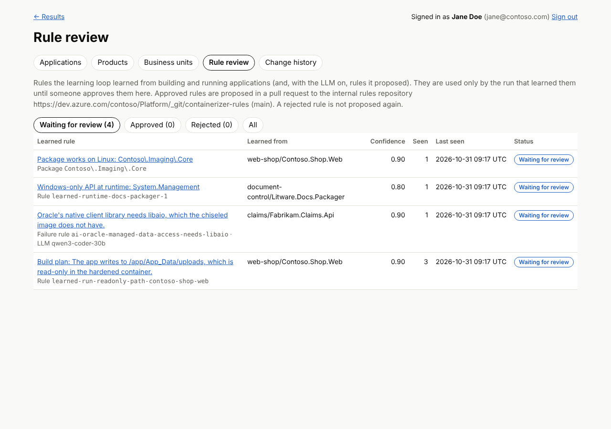

# Rule review: approving what the learning loop learns

The learning loop (`verify --learn`, `analyze`, `org` runs, the scan worker and `ai --learn`) builds
and runs applications, matches failures against the failure rules, patches the build plan and retries.
What worked used to be written straight into `rules/learned/`. Now nothing the loop learns enters the
ruleset until a person approves it:

1. **The run uses what it learns, and nothing else does.** A learning run gets a staging copy of the
   learned rules. Its own re-assessment and generated Dockerfiles use what it learned, so the result of
   the run is as good as before, but the ruleset that other runs read stays unchanged.
2. **What it learned waits as a candidate.** When the run ends, every new rule, failure rule and
   Linux-safe package becomes a pending candidate with its evidence trail.
3. **A person decides.** On the **Rule review** admin page, or with `containerizer rules`, an
   administrator approves the rule (optionally after editing it) or rejects it.
4. **Approved rules go into your internal rules repository**, never into this tool's public `rules/`
   folder: what your applications taught the tool stays inside your organization. Approval opens a
   pull request there (default; a public repository is refused) or writes to a local checkout of it.
   The tool loads them from `CONTAINERIZER_REVIEWED_RULES`. **Rejected rules are remembered** and not
   proposed again.

Every decision is in the change history.

## What a candidate shows

| | |
| --- | --- |
| The rule | As YAML, and as the diff of the ruleset file it is added to |
| Kind | A finding or plan rule (`70-reviewed.yaml`), a failure rule of the build-and-run loop (`55-reviewed-failures.yaml`), or a package proven to work on Linux (`packages-reviewed.yaml`); files in the internal rules repository |
| Source | `learned` (from a build and run) or `ai` (proposed by the LLM, with the model's name) |
| Confidence | The rule's own confidence if it has one (0.7 for LLM rules), else 0.9 when the container built and ran with it, 0.8 for a failure observed at runtime, 0.6 otherwise |
| Seen | How many runs learned the same rule, first and last time |
| Evidence | For each run (the latest 20): repository URL and commit, application and component, the verification outcome, every attempt (which failure rule matched, its outcome, the exit code, the diagnosis), and the tail of the failing build or run log |

Logs are stored with credentials masked (passwords and keys in connection strings, `Authorization`
headers, user:password in URLs, JSON web tokens, private keys). The masking catches the common forms,
not every secret an application can print, so the pages and tables are for administrators only: the
results pages and the reader login cannot see them.

The same rule learned again (same condition and effect, whatever its id, date or wording) adds
evidence to its candidate instead of creating another. That identity is the rule's *fingerprint*: a
hash of everything except `id`, `learned_at`, `learned_from`, `model`, `confidence`, `source`,
`why`, `fix` and `refs`.

## Reviewing on the admin page

**Admin → Rule review** lists what is waiting, with filters for approved and rejected rules. Open a
rule to see the YAML, the diff and the evidence, then:

- **Approve**: the rule in the text box is what gets approved, so edit it there first if it needs a
  better id, a wider or narrower condition, a clearer explanation or a reference. The page lists what
  must change before a rule can be approved.
- **Reject**, with a reason. The same rule is not proposed again.




Who may review: the administrators (`CONTAINERIZER_ADMINS`). The pages sit behind one role gate,
`RULE_REVIEW_ROLES` in `containerizer/admin.py`, which already lists `operator`: once sign-in gives
operators that role, they can review rules too, without access to the other admin pages.

### What approval checks

A learned rule has to meet the same bar as the curated ones (the checks in `tests/test_rule_docs.py`):

- a unique id (lower-case letters, digits, `.`, `-`, `_`), not already used by a curated or approved rule;
- every regular expression in `when` compiles; the condition is not empty;
- finding rules: a title, a `why` of at least 60 characters, a `fix`, and at least one https reference
  for refactor, rewrite and blocker findings;
- plan rules and failure-rule fixes only use known build-plan keys;
- failure rules: stage, outcome and a `match` that does not match an empty log;
- packages: a valid expression that does not match (almost) any package name.

## Where approved rules go: your internal rules repository

Approved rules describe your applications (their names, packages and failures), so they are kept in a
Git repository inside your organization, not in this tool's public repository. Create a private or
internal repository for them (it can start empty) and point the tool at it:

| Variable | Meaning |
| --- | --- |
| `CONTAINERIZER_REVIEWED_RULES` | Folder of a checkout of the internal repository's rules (for example `/srv/containerizer-rules/rules`). Every run loads the approved rules from here, with the curated ones. Keep it current with a `git pull` before scans (the scan worker host, a CI step). |
| `CONTAINERIZER_RULES_APPLY` | `pr` (default): approving opens a pull request in the internal repository. `direct`: approving appends to the files in `CONTAINERIZER_REVIEWED_RULES` (commit them yourself). |
| `CONTAINERIZER_RULES_REPO` | https URL of the internal repository |
| `CONTAINERIZER_RULES_TOKEN` | A token that can read the repository's settings, push a branch and open a pull request (or name another variable with `CONTAINERIZER_RULES_TOKEN_ENV`) |
| `CONTAINERIZER_RULES_BRANCH` | Branch the pull request targets (default `main`) |
| `CONTAINERIZER_RULES_PATH` | Folder of the rules in that repository (default `rules`; created by the first approval) |
| `CONTAINERIZER_RULES_PROVIDER` | `github`, `gitlab` or `azure-devops`; worked out from the URL for github.com, gitlab.com / `gitlab.*` hosts, dev.azure.com and `*.visualstudio.com` |
| `CONTAINERIZER_RULES_API_URL` | API of a self-hosted GitHub Enterprise Server or GitLab, if it is not the usual address |

Safeguards:

- Before anything is pushed, the repository's visibility is read with the token: only `private` or
  `internal` repositories (Azure DevOps: a private project) are accepted. A public repository, or one
  whose visibility the token cannot read, is refused and the rule stays pending.
- `direct` refuses a folder inside this tool's own checkout.
- Approved rules are never written into this tool's `rules/` folder, so they cannot end up in a pull
  request to the public repository.

With `pr`, approving clones the internal repository, appends the rule to the right file on the branch
`containerizer/rule-review-<candidate>`, pushes it and opens the pull request. The pull request names
the reviewer and their note, and contains the rule but not the evidence logs. Approving the same
candidate again after a failure reuses the branch and the open pull request. Give the token only the
rights it needs on that one repository: contents and pull requests write plus metadata read (GitHub
fine-grained token), Developer (GitLab), or Code read & write (Azure DevOps).

When approving is not configured, the admin pages still work and the Rule review page says what to set.

The approved files are loaded after the curated rules: `70-reviewed.yaml` with the finding and plan
rules, `55-reviewed-failures.yaml` with the failure rules, and `packages-reviewed.yaml` with the
package lists. Each approved rule carries `reviewed: {candidate, by, at}`. Editing or deleting approved
rules by hand later is fine; new approvals are appended to the end of the file.

## Command line

The same review without the web UI, for headless use and scripts:

```bash
containerizer rules list                       # waiting for review (--status approved|rejected|all, --json)
containerizer rules show 12                    # the rule, the diff and the evidence
containerizer rules approve 12 --note "checked against two more apps"
containerizer rules approve 12 --edit fixed.yaml --note "narrowed to the package"
containerizer rules reject 13 --note "duplicates build-rid-downgrade"
```

`--as` (or `CONTAINERIZER_REVIEWER`) names the reviewer for the change history (default: the OS user).
Approving uses the `CONTAINERIZER_RULES_*` settings above.

## Where candidates are kept

- **With the results database** (`--sql` or `CONTAINERIZER_SQL`): in `containerizer.RuleCandidate`
  and `containerizer.RuleEvidence`. The scan's writer login may only run the
  `ProposeRuleCandidate` procedure, which sets the status itself: it cannot read candidates, approve or
  reject. Reviewing uses the admin login (`CONTAINERIZER_ADMIN_SQL` for the CLI, as for the admin
  pages), with the reviewer recorded in the change history (`containerizer.AuditLog`, table
  `RuleCandidate`). `containerizer db init` creates the tables (schema version 6).
- **Without a database**: in `.work/rule-review/candidates.json` (or `CONTAINERIZER_REVIEW_DIR`, or
  `containerizer rules --dir`), for a single machine.

```sql
-- what is waiting, most often seen first
SELECT CandidateId, Kind, RuleId, Title, Confidence, SeenCount, LastSeenAt, LearnedFrom, Model
FROM containerizer.RuleCandidate WHERE Status = N'pending' ORDER BY SeenCount DESC, LastSeenAt DESC;
```

## Turning it off

`CONTAINERIZER_RULE_REVIEW=off` restores the old behaviour for experiments on one machine: learning
runs write straight into `rules/learned/`, and nothing is proposed.

A learning run points the learned folder at its staging copy for the whole process, so run one learning
run per process at a time (the CLI, the organization runner and the scan worker do).
