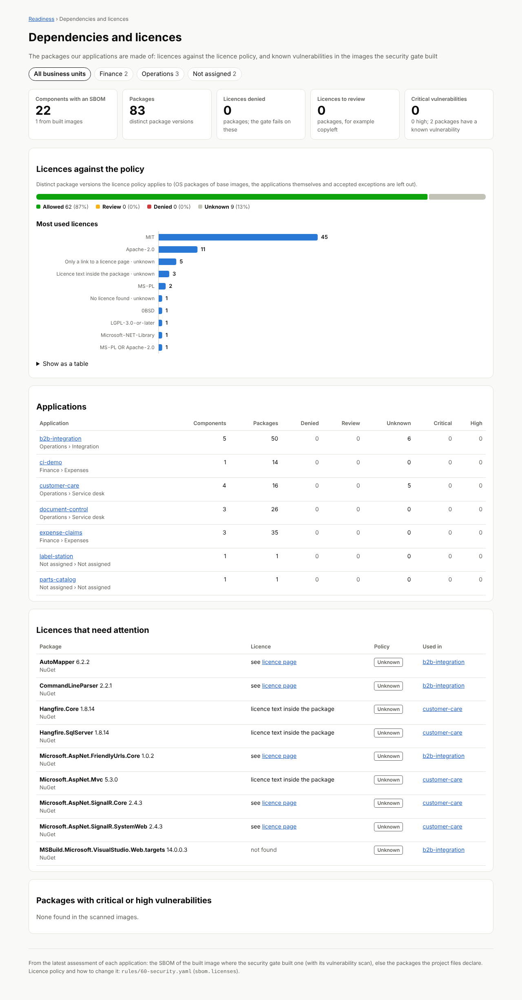
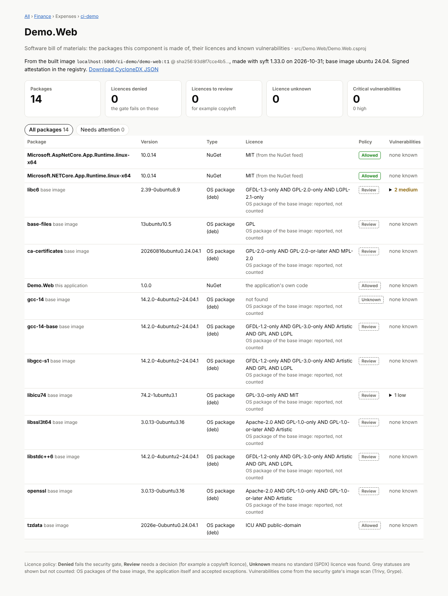

# Software bills of materials, licences and CVEs per package

Every image the security gate builds gets a **software bill of materials** (SBOM) in CycloneDX JSON.
Each package in it is checked against a **licence policy** and gets the **vulnerabilities** the gate's
image scan found in it. The SBOM is written next to the component's generated files, stored in the
results database, attached to the pushed image in the registry, and shown in the web UI and the API.

| Where | What |
| --- | --- |
| `gate --build`, `org` | `sbom.cdx.json` next to each component's `Dockerfile`, a summary in `security.json` / `SECURITY.md`; the gate **fails on a denied licence** (and an organization run leaves the component out) |
| `org` with `--sql` | the image SBOM in SQL Server, linked to that run's assessment and the component |
| `org`, after the push | the SBOM in the registry next to the image: a **signed attestation** with `--cosign-key`, else an OCI referrer artifact |
| output repository | `<Org>/<Project>/<Repo>/<component>/sbom.cdx.json` |
| `assess` / `analyze` with `--sql` | a **source SBOM** per component from its project files (no build needed) |
| web UI | packages of each component, and a portfolio page of licences and CVEs per business unit and product |
| API | `/api/v1/applications/{id}/components/{cid}/sbom`, `/api/v1/sbom/packages`, `/api/v1/sbom/summary` |
| `containerizer sbom IMAGE` | the same for any image, on the command line |

Settings live in [`rules/60-security.yaml`](../rules/60-security.yaml) under `sbom:`; the code is
[`containerizer/sbom.py`](../containerizer/sbom.py).

## How an SBOM is made

**Image SBOM.** [Syft](https://github.com/anchore/syft) reads the built image from the local Docker
daemon (`syft scan docker:<image> -o cyclonedx-json`): OS packages (dpkg, apk, rpm) with the licences
from their copyright files, .NET packages from the `*.deps.json` files of the application and the
runtime, npm, Python, Java and Go packages. Syft runs from `PATH` if it is installed, else as the
container `anchore/syft` (version pinned in `sbom.generator.image`), with the same proxy and CA bundle
handling as the scanners.

**NuGet licences.** Syft does not read NuGet licences, so containerizer looks them up in each
package's `.nuspec` on the NuGet feed (`sbom.nuget_feed`, the v3 service index; nuget.org by default):
the licence expression when there is one, else the licence URL of older packages, mapped to an SPDX
identifier where the URL names one licence unambiguously (`licenses.nuget.org/MIT`, the Apache and
Open Source Initiative pages, the old .NET Library licence). Answers are cached under `.work/` so a
package version is looked up once. The licence found is also written into the SBOM file.
`nuget_licenses: false` turns this off for runners without access to the feed; private feeds that
need credentials are not queried (those packages show as *unknown*).

**Source SBOM.** For components that are not built, `assess` and `analyze` with `--sql` store the
packages the component's project files declare, including those of the projects it references:

- a **lock file** gives every runtime package with its exact version: `package-lock.json` (npm,
  lockfile v2/v3 also carry the licence; development packages are left out) or `packages.lock.json`
  (NuGet, when the project restores with a lock file);
- otherwise the declared references (`PackageReference`, `packages.config`, `package.json`
  dependencies, `requirements.txt`, ...). A version range or floating version (`8.0.*`, `^1.2.0`) is
  kept as written and left out of the package URL; transitive packages appear only in the image SBOM.

Nothing from the repository is executed. Source SBOMs have no CVE data: nothing was scanned. Turn
them off with `sbom.source: false`. On the component page and in the API, the image SBOM wins when
both exist for the latest assessment.

## Licence policy

Each package's licence is normalised to an SPDX expression where the data allows it. Several
licences listed on one package all apply (`A AND B`): a Debian package lists the licence of every
file it ships. An expression is judged as written: `A OR B` passes when either passes, `A AND B`
needs both, and `WITH <exception>` is judged by the licence it modifies.

```yaml
sbom:
  os_packages: report         # report | evaluate
  licenses:
    deny: []                  # fail the gate
    warn: ['AGPL(-.*)?', 'GPL(-.*)?', 'SSPL(-.*)?', 'CC-BY-NC(-.*)?', 'BUSL(-.*)?|Elastic-2\.0|Commons-Clause']
    allow: ['LicenseRef-public-domain', 'LicenseRef-Microsoft-NET-Library']
    unknown: report           # report | warn | deny
    accepted:                 # exceptions with a reason and an optional expiry
      - {package: 'Ghostscript\.NET', reason: 'separate commercial licence, contract 2026-114', expires: 2027-06-30}
```

The lists hold regular expressions matched against each whole SPDX identifier (case-insensitive), so
`GPL(-.*)?` matches `GPL-2.0-only` and `GPL-3.0-or-later` but not `LGPL-2.1-only`. The result per
package is one of:

| Status | Meaning |
| --- | --- |
| **Allowed** | an SPDX licence the lists do not deny or flag, or one on `allow` |
| **Review** (`warn`) | the policy asks for a decision, for example a copyleft licence |
| **Denied** | the policy does not allow it: the security gate fails |
| **Unknown** | no licence found, only a link to a licence page, or a name that is not an SPDX identifier (`unknown:` decides whether that warns or fails) |

Shown but **not counted**: OS packages of the base image (unless `os_packages: evaluate`; the
copyright files make glibc read "GPL AND LGPL", which says little about an application that runs on
it), the application's own assembly, and packages with an accepted exception (until it expires).
SPDX identifiers are recognised from [`rules/spdx-licenses.yaml`](../rules/spdx-licenses.yaml), a copy
of the SPDX License List.

## CVEs per package

The gate's image scan (Trivy and Grype, merged; see [Security gate](../README.md#security-gate))
reports each finding with its package URL. Findings are matched to SBOM packages by package URL
(ignoring qualifiers such as `distro=`), else by name and version. A vulnerable package the SBOM does
not list is added as its own row (*found by the vulnerability scan*), so no CVE is dropped. The SBOM
does not change what fails the gate on vulnerabilities: that is still `scan.fail_on` and
`scan.allowlist`.

## In the registry

After `containerizer org` pushes an image, the SBOM goes next to it, addressed by the image digest:

- **With `--cosign-key`**: `cosign attest --type cyclonedx --predicate sbom.cdx.json <image>@<digest>`,
  a signed in-toto attestation. Verify it with
  `cosign verify-attestation --key cosign.pub --type cyclonedx <image>@<digest>`. cosign records the
  signature in the public Rekor transparency log by default; for a private registry whose image names
  must not appear there, set `sbom.cosign_tlog_upload: false` and verify with
  `--insecure-ignore-tlog` (or a private Rekor).
- **Without a key**: an OCI referrer artifact of type `application/vnd.cyclonedx+json`, attached with
  [ORAS](https://oras.land) (`oras attach`). List it with `oras discover <image>@<digest>`, fetch it with
  `oras pull`. `sbom.attach: false` turns this off.

Registry credentials are the same as for the push (`REGISTRY_USERNAME` / `REGISTRY_PASSWORD`, kept in
a temporary Docker config). The result (`attested`, `attached`, or why not) is stored with the SBOM and
shown on the component page.

## Results database

`containerizer db init` creates the tables from [`containerizer/sql/sbom.sql`](../containerizer/sql/sbom.sql)
next to the rest of the schema:

```
ApplicationAssessment 1─* ComponentSbom 1─* SbomPackage
                          (Kind image|source, ImageRef, ImageDigest, Tool, Attestation, Document = CycloneDX JSON)
                                             (Name, Version, Type, Purl, License, LicenseStatus, Scope,
                                              PolicyApplies, Critical, High, Medium, Low, Vulns = JSON)
```

| View | For |
| --- | --- |
| `vSbomLatest` | the SBOM of each component in the latest assessment (image preferred over source) |
| `vSbomPackageLatest` | its packages, with application, product and business unit |
| `vSbomDocumentLatest` | the CycloneDX documents (download) |

The scanner role inserts; the reader role reads the views only. Useful queries:

```sql
-- every package with a denied licence or a critical CVE, by business unit
SELECT COALESCE(BusinessUnitName, N'(not assigned)') AS BusinessUnit, ApplicationName, ComponentName,
       Name, Version, License, LicenseStatus, Critical, High
FROM containerizer.vSbomPackageLatest
WHERE (PolicyApplies = 1 AND LicenseStatus = 'denied') OR Critical > 0
ORDER BY BusinessUnit, ApplicationName, Critical DESC;

-- where is a package used (e.g. after a new advisory)?
SELECT ApplicationName, ComponentName, Version, Kind FROM containerizer.vSbomPackageLatest
WHERE Name = N'Newtonsoft.Json' ORDER BY Version;
```

## Web UI

- **Application page**: a *Packages* column per component with the package count, denied and
  to-review licences and critical/high CVEs, linking to the component page.
- **Component page** (`/app/{id}/component/{cid}`): every package with version, type, licence and its
  policy status, and its CVEs with the fixed version and a link to the advisory; a *Needs attention*
  filter; *Download CycloneDX JSON*.
- **Dependencies and licences** (`/sbom`, linked from the overview): licence status across the
  portfolio, the most used licences, a table per application, the licences that need attention and
  the packages with critical or high CVEs, filterable by business unit and product. Every chart has
  a table view.





When the results pages require sign-in (`CONTAINERIZER_VIEWERS`), these pages and the download do too.

## API

Read-only, with the same bearer-token authentication as the rest of the [API](results-database.md#api):

```sh
# packages of one component (licence, status, CVEs), or the CycloneDX document
curl -H "Authorization: Bearer $TOKEN" https://cz.example.com/api/v1/applications/12/components/40/sbom
curl -H "Authorization: Bearer $TOKEN" "https://cz.example.com/api/v1/applications/12/components/40/sbom?format=cyclonedx"
# across the portfolio: licences to review or denied in one business unit
curl -H "Authorization: Bearer $TOKEN" "https://cz.example.com/api/v1/sbom/packages?businessUnitId=3&licenseStatus=warn,denied"
# packages with known CVEs, and the numbers of the portfolio page
curl -H "Authorization: Bearer $TOKEN" "https://cz.example.com/api/v1/sbom/packages?vulnerable=true&limit=500"
curl -H "Authorization: Bearer $TOKEN" "https://cz.example.com/api/v1/sbom/summary?businessUnitId=3"
```

`businessUnitId` and `productId` take an id or `none` (not assigned); `licenseStatus` takes
`allowed`, `warn`, `denied`, `unknown` (comma-separated); `limit` is at most 10000.

## Command line

```sh
python -m containerizer sbom myregistry.example.com/app/web:1.4 --remote --scan --out web.cdx.json
python -m containerizer gate path/to/app --out out/            # sbom.cdx.json per built component
python -m containerizer gate path/to/app --out out/ --no-sbom  # without
```

`containerizer sbom` prints the packages with licence, status and CVE counts and exits with 1 when a
licence is denied.
