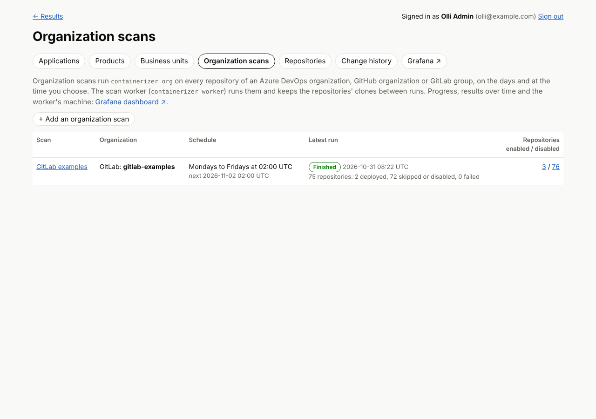
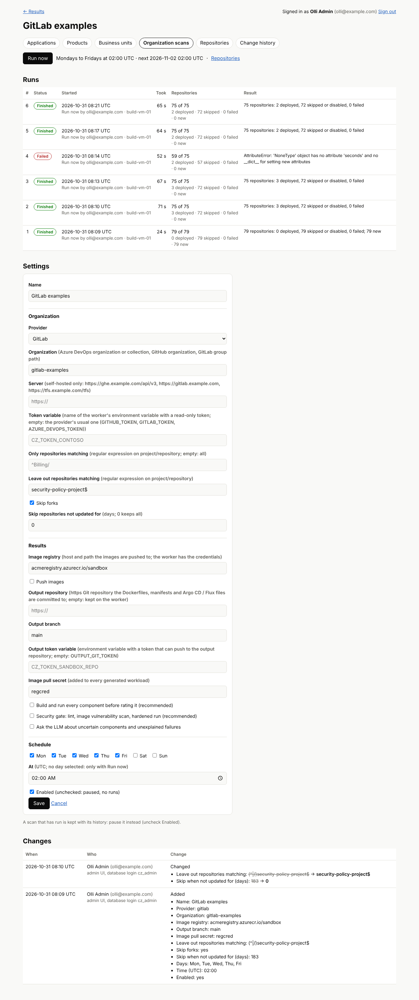
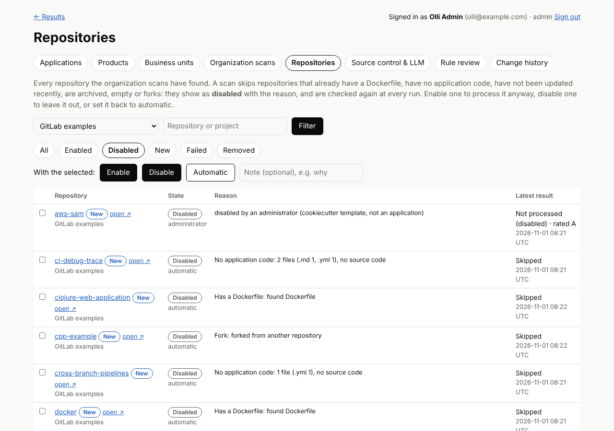
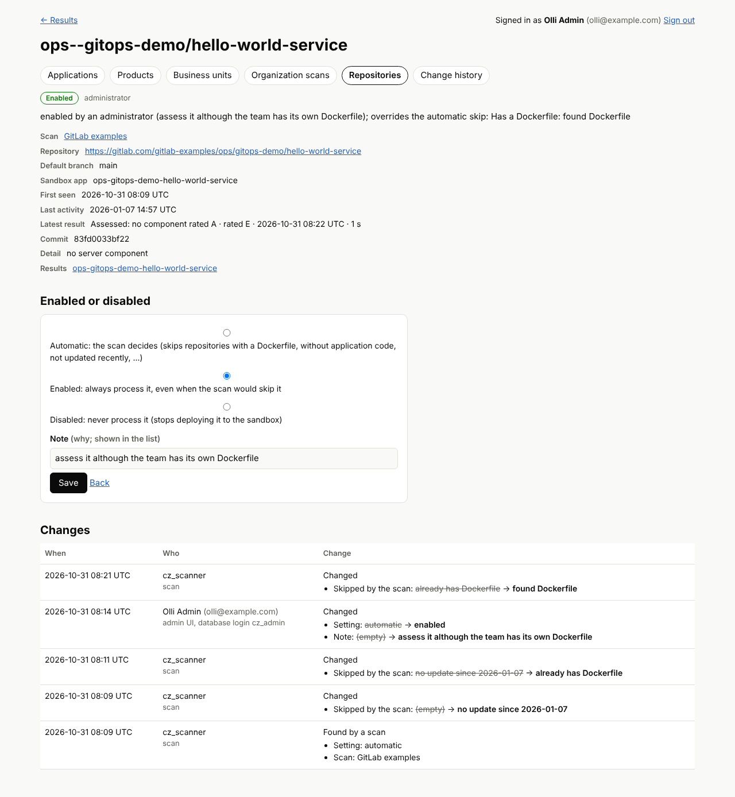
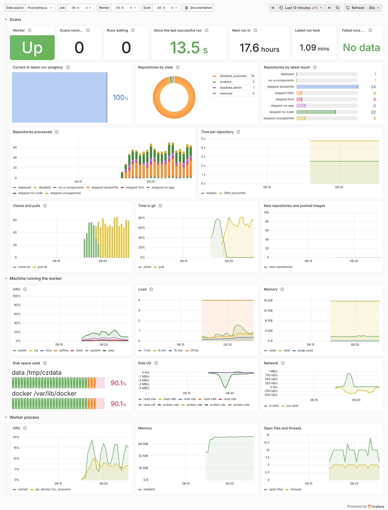

# Scheduled organization scans

Administrators schedule [organization-wide runs](organization-run.md) on the [admin pages](results-database.md#admin-pages)
of the web UI, and a **scan worker** (`containerizer worker`) on a build machine with Docker runs them.

- **Organization scans**: which Azure DevOps organization, GitHub organization or GitLab group, where the
  images and the generated files go, which repositories (filters), and on which days and at what time
  (UTC) to run. **Run now**, cancel, and every run with its progress and result.
- **Clones are kept**: the worker clones every repository once and later only fetches the newest commit
  of the default branch (shallow), then resets the work tree to it. Clones of repositories the
  organization no longer has are deleted.
- **New repositories are found automatically**: every run lists the organization again. New
  repositories are added (and processed in that run), renamed ones are followed by the provider's id,
  and ones that are gone are marked **removed**.
- **Repositories without application code are skipped**, as well as ones that already have a Dockerfile,
  have not been updated recently, are archived, empty or forks. They show as **disabled, with the reason**.
- **Administrators enable or disable repositories** after the first scan, one by one or in bulk, with
  a note. Every change is in the change history.
- **Prometheus metrics** about the scans, the worker process and the machine it runs on, alert rules,
  and a **Grafana dashboard**.



## How it fits together

```
 browser ──SSO──> web UI (admin pages) ──admin login──> SQL Server <──writer login── containerizer worker ──> Docker
                  no tokens, no Docker                  OrgScan, OrgScanRun,          org tokens, registry      │
                                                        OrgRepository, AuditLog       credentials, clones       ├─> registry
                                                                                                                ├─> output Git repo
                                                                     Prometheus ──scrape /metrics──┘            └─> Argo CD / Flux
```

The web UI only stores what to scan and when; it never holds the organization's, the output
repository's or the registry's credentials and does not need Docker. The worker holds them as
environment variables. A scan only *names* the variable with its token, and only `CZ_TOKEN_*` names
or the providers' usual ones (`GITHUB_TOKEN`, `GITLAB_TOKEN`, `AZURE_DEVOPS_TOKEN`, `OUTPUT_GIT_TOKEN`,
...) are accepted, so a scan can never make the worker send its database password or registry
password anywhere. Tokens go only to `github.com`, `api.github.com`, `gitlab.com`, `dev.azure.com`,
`*.visualstudio.com` and the hosts listed in `CONTAINERIZER_WORKER_HOSTS` (self-hosted servers and the
image registry): a scan whose server, output repository or registry is elsewhere does not run, and a
clone URL on another host is refused.

## Setting it up

1. Upgrade the database schema (adds the tables, the audit triggers and the grants), as a database owner:

   ```sh
   CONTAINERIZER_SQL="Server=...;Database=Containerizer;User Id=<owner>" python -m containerizer db init
   ```

2. The admin pages show **Organization scans** and **Repositories** to administrators; nothing else
   to configure in the web UI.

3. Run the worker on a **dedicated, disposable build VM** with Docker. Building and running the
   repositories' images executes their build steps, as `analyze` and `gate` always do, so give the VM
   no other credentials and no access to production networks.

### Running the worker

```sh
sudo useradd --system --home /var/lib/containerizer --groups docker containerizer
sudo git clone https://github.com/olljanat-ai/containerizer /opt/containerizer
sudo python3 -m venv /opt/containerizer/.venv
sudo /opt/containerizer/.venv/bin/pip install -r /opt/containerizer/requirements.txt -r /opt/containerizer/requirements-sql.txt
sudo install -d -m 700 /etc/containerizer
sudo install -m 600 /opt/containerizer/monitoring/systemd/worker.env.example /etc/containerizer/worker.env   # fill it in
sudo cp /opt/containerizer/monitoring/systemd/containerizer-worker.service /etc/systemd/system/
sudo systemctl daemon-reload && sudo systemctl enable --now containerizer-worker
journalctl -u containerizer-worker -f
```

Install Trivy or Grype for the security gate (or let the gate run them in Docker), and cosign if
scans sign images. The worker runs directly on the VM, not in a container: the build-and-run
verification reaches the containers it starts on `127.0.0.1`, and the scanners mount host folders.

| Option / variable | Meaning |
| --- | --- |
| `CONTAINERIZER_SQL` / `--sql`, `CONTAINERIZER_SQL_PASSWORD` | A login in the `containerizer_writer` role (the same role as the scanner). |
| `--data-dir` | Clones (`scan-<id>/repos`), work folders and, for scans without an output repository, the generated files (`scan-<id>/output`). Default `/var/lib/containerizer`, mode 700. |
| `--poll` | Seconds between checks for due scans and queued runs (default 30). |
| `--name` | Worker name shown on the runs (default the host name). |
| `--metrics-host`, `--metrics-port`, `--no-metrics` | The metrics endpoint, default `127.0.0.1:9464`. |
| `--once` | Run what is due or queued, then exit (for a cron job instead of a service). |
| `CZ_TOKEN_<NAME>`, `GITHUB_TOKEN`, `GITLAB_TOKEN`, `AZURE_DEVOPS_TOKEN` | Read-only organization tokens, named in each scan's *Token variable*. See [organization-run.md](organization-run.md) for the scopes. |
| `OUTPUT_GIT_TOKEN` or `CZ_TOKEN_<NAME>` | Push access to the output repository (*Output token variable*). |
| `REGISTRY_USERNAME`, `REGISTRY_PASSWORD` | Push-only registry credentials (or an existing `docker login` of the worker's user). |
| `CONTAINERIZER_WORKER_HOSTS` | Extra hosts that may receive tokens, comma separated, `*.example.com` for subdomains: self-hosted servers and the image registry. |
| `CONTAINERIZER_METRICS_TOKEN` | When set, scrapes must send `Authorization: Bearer <token>`. |

`SIGTERM` (systemctl stop) lets the worker finish the repository it is on; the run is then marked
**cancelled**. If the worker dies, its run is marked **failed** after 10 minutes without a heartbeat
(or at once when the same worker starts again). The next run processes every repository again, so
nothing is lost. Several workers can share one database: each run is taken by exactly one of them,
and each worker keeps its own clones.

## Organization scans



A scan has the same settings as `containerizer org` ([organization-run.md](organization-run.md)):
provider and organization (and the server for self-hosted Azure DevOps Server, GitHub Enterprise or
GitLab), the token variable, include/exclude filters (regular expressions on `project/repository`),
skip forks, skip repositories not updated for N days, the image registry and whether to push, the
output repository, branch and token variable (empty: the generated files stay on the worker), an
image pull secret, build-and-run verification, the security gate and the LLM.

**Schedule**: the days of the week and a time in UTC; no day selected means only **Run now**. The worker
queues a run when it is due; if it was down at the time, it runs once when it is back. A scan runs at
most once at a time: Run now while one is queued or running does nothing. **Paused** (Enabled
unchecked) scans do not run at all. Changing the settings takes effect at the next run.

Each run shows who or what started it, the worker, how long it took, its progress while running
(repositories done of all, the one it is on), and how many repositories were deployed, skipped or
disabled, failed, and new. **Cancel** stops a queued run at once and a running one after the
repository it is on. A scan that has run cannot be deleted (its history is kept): pause it.

## Repositories



Every repository any scan has found, filterable by scan, by state (all, enabled, disabled, new in the
last 7 days, failed in the latest run, removed) and by name. Each shows whether it is **enabled** or
**disabled**, who decided (**automatic**: the scan; **administrator**), the reason, and its latest
result with the rating.

| Automatic skip | Reason shown, for example |
| --- | --- |
| Has a Dockerfile | `found src/Api/Dockerfile`: the team already containerizes it |
| No application code | `14 files (.md 9, .yml 3, .json 2), no source code`: documentation, configuration, pipelines, SQL or shell scripts |
| Language not supported | `Ruby (32 files), but no project the tool can build (...)`: source code, but no .NET project, `package.json`, `requirements.txt`/`pyproject.toml`, `pom.xml`/`build.gradle` or `go.mod` |
| Nothing to deploy | `only library, test: 3 projects, nothing that runs on its own` |
| Not updated recently | `no update since 2026-01-07` (the scan's *skip repositories not updated for*) |
| Archived, Empty, Fork | as the provider reports |
| Left out by the filter | the scan's include/exclude filters |

Automatic skips are checked again at every run, so a repository that gets new commits or loses its
Dockerfile is processed again by itself. Archived, empty, filtered and stale repositories are decided
from the provider's API without fetching anything; the others need the newest commit, which the
worker fetches into its clone.

Select repositories and press **Enable** (always process it, even when an automatic skip applies: the
skip is still shown as overridden), **Disable** (never fetch or process it; it is also removed from the
sandbox deployment at the next run) or **Automatic** (the scan decides again), with an optional note.
The same is on each repository's page, with its details, the deployed and excluded components, a link
to its results, and its change history.



The change history (**Change history → Repositories**, and on each page) records repositories found by a
scan, enabled, disabled or set back to automatic by whom with the note, automatic skips that start or
stop applying, and repositories that leave the organization; and every change to a scan's settings.

## Metrics

The worker serves Prometheus metrics at `http://<metrics-host>:9464/metrics` (text format 0.0.4) and a
plain `/healthz`. It listens on 127.0.0.1 by default: to scrape it from another machine, start it with
`--metrics-host` set to the VM's private address, keep the port behind a firewall, and set
`CONTAINERIZER_METRICS_TOKEN`. Example scrape configuration and alert rules:
[`monitoring/prometheus/scrape.yml`](../monitoring/prometheus/scrape.yml),
[`monitoring/prometheus/containerizer-alerts.yml`](../monitoring/prometheus/containerizer-alerts.yml)
(worker down, run failed, no successful run for 8 days, runs not starting, repositories failing, disk
over 90 %, memory low).

| Metric | Type | Labels | Meaning |
| --- | --- | --- | --- |
| `containerizer_worker_info` | gauge | worker, version | Always 1 |
| `containerizer_worker_busy` | gauge | | 1 while running a scan |
| `containerizer_worker_last_poll_timestamp_seconds` | gauge | | Last check for due scans |
| `containerizer_worker_poll_errors_total` | counter | | Failed checks (database unreachable) |
| `containerizer_scan_info` | gauge | scan, provider, organization, enabled | Scans defined on the admin pages |
| `containerizer_scan_runs_total` | counter | scan, status | Finished runs: succeeded, failed, cancelled |
| `containerizer_scan_running` | gauge | scan | 1 while a run is in progress |
| `containerizer_scan_last_start_timestamp_seconds`, `..._last_end_...`, `..._last_success_...` | gauge | scan | Times of the latest run |
| `containerizer_scan_last_duration_seconds` | gauge | scan | Duration of the latest run |
| `containerizer_scan_next_run_timestamp_seconds` | gauge | scan | Next scheduled run |
| `containerizer_scan_queued_runs` | gauge | | Runs waiting for a worker |
| `containerizer_scan_run_repositories`, `containerizer_scan_run_repositories_done` | gauge | scan | Progress of the current or latest run |
| `containerizer_scan_repositories_processed_total` | counter | scan, status | Repositories processed, by result (deployed, no-a-components, skipped-*, disabled, error) |
| `containerizer_scan_repository_duration_seconds` | histogram | scan | Time per repository |
| `containerizer_scan_repositories` | gauge | scan, state | enabled, disabled_automatic, disabled_admin, removed |
| `containerizer_scan_repositories_last_status` | gauge | scan, status | Repositories by latest result |
| `containerizer_scan_new_repositories_total` | counter | scan | Repositories found for the first time |
| `containerizer_scan_git_operations_total` | counter | scan, operation, result | Clones and pulls, ok or failed |
| `containerizer_scan_git_seconds_total` | counter | scan, operation | Time spent in git |
| `containerizer_scan_images_pushed_total` | counter | scan | Images pushed |
| `process_cpu_seconds_total`, `process_resident_memory_bytes`, `process_virtual_memory_bytes`, `process_open_fds`, `process_max_fds`, `process_threads`, `process_start_time_seconds` | | | The worker process (standard names) |
| `containerizer_process_children_cpu_seconds_total` | counter | | CPU of the tools it starts (git, docker CLI, scanners) |
| `containerizer_host_cpu_seconds_total` | counter | mode | CPU time of the machine by mode (user, system, idle, iowait, steal, ...) |
| `containerizer_host_cpus`, `containerizer_host_load1`, `..._load5`, `..._load15` | gauge | | CPUs and load average |
| `containerizer_host_memory_total_bytes`, `..._memory_available_bytes`, `..._swap_total_bytes`, `..._swap_free_bytes` | gauge | | Memory |
| `containerizer_host_filesystem_size_bytes`, `..._avail_bytes`, `..._files_free` | gauge | path, use | The data folder's file system and Docker's (`/var/lib/docker`) |
| `containerizer_host_disk_read_bytes_total`, `..._written_bytes_total`, `..._io_time_seconds_total` | counter | device | Disk I/O |
| `containerizer_host_network_receive_bytes_total`, `..._transmit_bytes_total` | counter | device | Network (physical interfaces) |

Machine metrics are read from `/proc`, so they describe the whole VM (Docker builds included), and are
prefixed `containerizer_host_` so they do not clash with node_exporter. For the full set of machine
metrics (per-CPU, file system per mount, pressure stall information, systemd, ...) run
[node_exporter](https://github.com/prometheus/node_exporter) on the VM as well and scrape it as a
second job (commented in `scrape.yml`); Grafana's *Node Exporter Full* dashboard (id 1860) covers it.

### Grafana dashboard

Import [`monitoring/grafana/containerizer-scans.json`](../monitoring/grafana/containerizer-scans.json)
(Dashboards → New → Import) and pick your Prometheus data source. Variables: job, worker (instance),
scan.

Set `CONTAINERIZER_GRAFANA_URL` on the web UI to the dashboard's address (for example
`https://grafana.example.com/d/containerizer-scans`) and the admin pages link to it:
a **Grafana ↗** tab on every admin page and a link on Organization scans. It must be `https://`
(`http://` is accepted only to `localhost`), and the web UI refuses to start with anything else.



- **Scans**: worker up, scans running, runs waiting, time since the last successful run, next run,
  latest run's duration, failed runs in 7 days; progress of the current run; repositories by state and
  by latest result; repositories processed over time by result; time per repository (median, 95th
  percentile); clones and pulls; time in git; new repositories and pushed images.
- **Machine running the worker**: CPU by mode, load against CPUs, memory, disk space of the data and
  Docker folders, disk I/O, network.
- **Worker process**: CPU (and its child processes), memory, open files and threads.

The screenshots on this page are from a trial run against the public GitLab group `gitlab-examples`
(79 repositories) with build-and-run, gate and image push turned off.

## Database

Schema version 3 adds, in the same dedicated schema:

| Table | Holds | Written by |
| --- | --- | --- |
| `OrgScan` | Scans: organization, results, filters, schedule; `NextRunAt` | admin pages (settings), worker (`NextRunAt`) |
| `OrgScanRun` | One row per run: who started it, status, worker, heartbeat, progress, counts, result | `QueueOrgScanRun` / `CancelOrgScanRun` procedures, worker |
| `OrgRepository` | Every repository found: names, URLs, first/last seen, removed; `SkipStatus`/`SkipReason` (automatic); `AdminState`/`AdminNote` (people); latest result; computed `Enabled` | worker, admin pages (`AdminState`, `AdminNote` only) |

The `containerizer_admin` role may change the scans and only `AdminState`/`AdminNote` of repositories,
and queue or cancel runs through the procedures; the `containerizer_writer` role (the worker) may read
the scans, set `NextRunAt`, update the runs and every repository column except the people's. The
`containerizer_reader` role (the results pages) sees none of it. Changes to `OrgScan` and
`OrgRepository` are written to `AuditLog` by triggers.

```sql
-- repositories an administrator disabled, and why
SELECT s.Name AS Scan, r.ProjectName, r.Name, r.AdminNote
FROM containerizer.OrgRepository r JOIN containerizer.OrgScan s ON s.ScanId = r.ScanId
WHERE r.AdminState = N'disabled';

-- why repositories are skipped, per scan
SELECT s.Name AS Scan, r.SkipStatus, COUNT(*) AS Repositories
FROM containerizer.OrgRepository r JOIN containerizer.OrgScan s ON s.ScanId = r.ScanId
WHERE r.RemovedAt IS NULL AND r.SkipStatus IS NOT NULL GROUP BY s.Name, r.SkipStatus;
```
